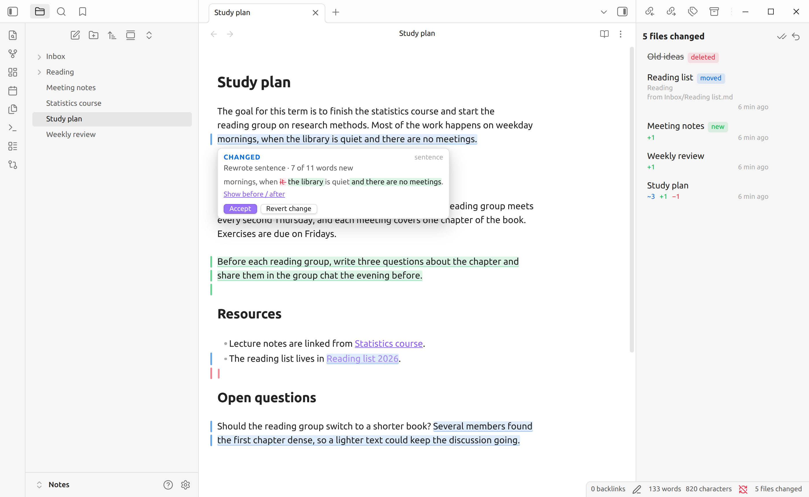
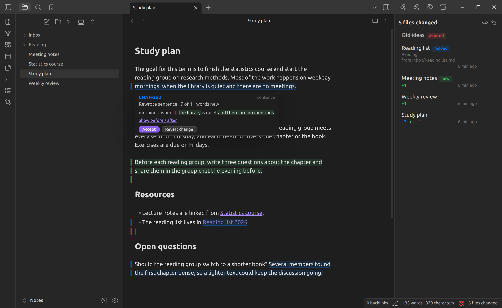
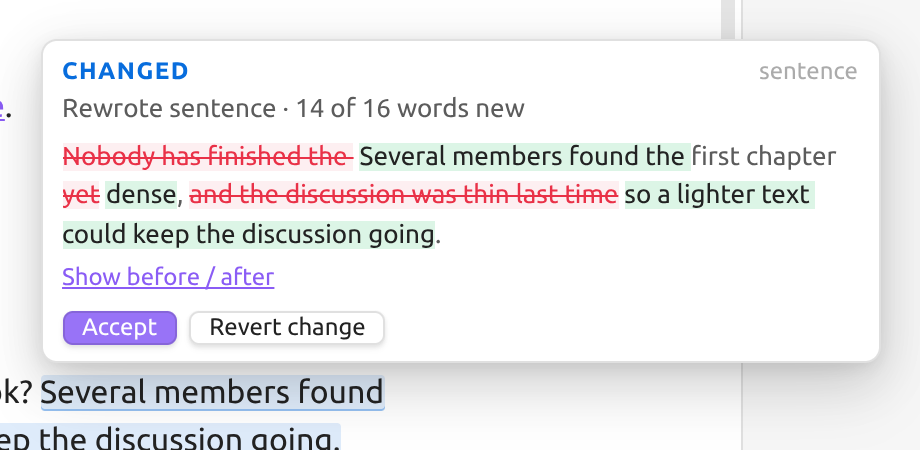
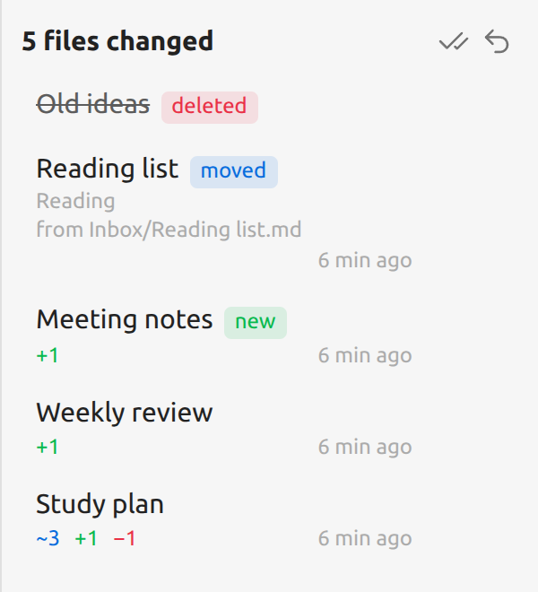
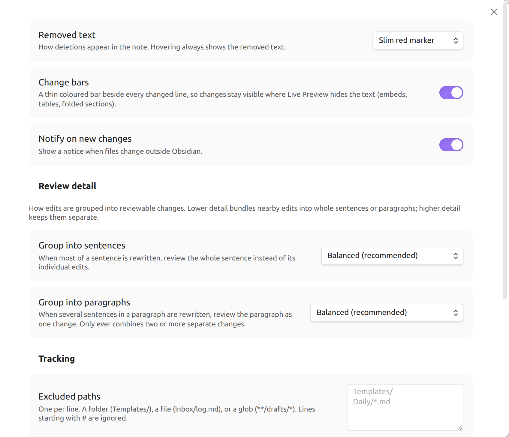

# Agent Change Review

**See exactly what an AI agent changed in your notes, right where it changed,
and accept or undo each edit.**

When something outside Obsidian edits your vault (Claude Code, Codex, Cursor,
a script, a `git pull`), Agent Change Review highlights the changes inside the
note itself:

- **blue** for changed text
- **green** for added text
- **red** for removed text

Hover a highlight to see what it said before, then **Accept** or **Revert** it.
Edits you type yourself are never highlighted.

Dark theme

## Why

Agents are good at editing Markdown, but reviewing their work is awkward: a
split diff in a terminal or git client takes you out of your writing, and
re-reading the whole note to spot what changed is slow. This plugin keeps you
in the note, shows each change in context, and lets you keep or undo it one
change at a time.

The plugin never writes content of its own and needs no AI service, account,
or network access.

## Install

**From Obsidian:** Settings → Community plugins → Browse → search for
"Agent Change Review" → Install → Enable.

Before it is listed: install with BRAT or by hand

**BRAT:** install the [BRAT](https://github.com/TfTHacker/obsidian42-brat)
plugin, choose *Add beta plugin*, and paste
`https://github.com/nkampel/agent-change-review`. BRAT keeps it updated.

**By hand:** download `main.js`, `manifest.json` and `styles.css` from the
[latest release](https://github.com/nkampel/agent-change-review/releases/latest),
put them in `<your vault>/.obsidian/plugins/agent-change-review/`, then reload
Obsidian and enable the plugin under Settings → Community plugins.

Desktop only (Windows, macOS, Linux). Requires Obsidian 1.8.7 or newer.

## Quick start

1. **Enable the plugin.** On first start it quietly records the current state
   of every note as "reviewed". Nothing is highlighted yet.
2. **Let an agent or tool edit your notes**, with Obsidian open or closed.
   A notice tells you which notes changed; changes made while Obsidian was
   closed are picked up at the next start.
3. **Review.** Open a changed note (or click the notice), hover a highlight,
   and choose **Accept** or **Revert**. The **Agent changes** panel lists every
   note that still has something to review.

## Reviewing a change

Hovering a highlight opens a small popup:

| Rewritten sentence | Changed link |
|---|---|
|  | ![Popup for a changed link: "Changed link [[Reading list]] → [[Reading list 2026]]"](docs/images/bubble-link.png) |

- A one-line summary, such as *Replaced 2 words with 3 words*, *Added
  sentence (12 words)* or *Formatting only*.
- Link and embed changes are called out, e.g. *Changed link
  `[[Reading list]]` → `[[Reading list 2026]]`*, since a changed target
  matters more than the prose around it.
- For rewritten sentences and paragraphs, the word-level detail shows what was
  removed and what was added. *Show before / after* switches to the full old
  and new text.
- **Accept** keeps the change. **Revert** puts back the original text (for an
  addition it removes the text; for a removal it restores it). A revert can be
  undone with Ctrl/Cmd+Z.

Nearby edits are grouped into one reviewable change, and a sentence or
paragraph that was mostly rewritten is reviewed as a whole. You can make this
more or less eager under *Review detail* in the settings.

## The Agent changes panel

Open it from the ribbon icon, the status bar counter ("5 files changed"), or the
command *Show pending changes*. It lists every note with unreviewed changes:

- **modified** notes, with counts of changed ~, added + and removed − parts;
- **new** notes an agent created: keep them, or move them to the trash;
- **deleted** notes: preview the deleted content, then accept the deletion or
  restore the file;
- **moved** notes: accept the new location, or move the note back.

Each row has accept-all and revert-all buttons, and the header has the same
for every note at once (with a confirmation).

## Reviewing with the keyboard

Bind *Go to next change* to a hotkey (Settings → Hotkeys, e.g. `Alt+N`). It
selects the next change and opens its popup. While a popup opened this way is
showing:

| Key | |
|---|---|
| `A` | Accept, then go to the next change |
| `R` | Revert, then go to the next change |
| `F` | Skip forward to the next change |
| `Esc` | Close the popup |

These single keys only work in that popup; a popup opened by hovering ignores
them, so they never interfere with typing.

## Commands

All commands are in the command palette. Assign hotkeys under
Settings → Hotkeys.

| Command | What it does |
|---|---|
| Go to next change / Go to previous change | Selects the change and opens its popup |
| Accept change at cursor / Reject change at cursor | Acts on the change under the cursor |
| Accept all changes in this note / Reject all changes in this note | |
| Show pending changes | Opens the Agent changes panel |

## Settings

- **Removed text:** show deletions as a slim red marker (default) or as
  struck-through text.
- **Change bars:** a coloured bar beside each changed line, so changes stay
  visible where Live Preview renders text as a widget (embeds, tables, the
  properties block).
- **Notify on new changes:** show a notice when notes change outside Obsidian.
- **Review detail:** how eagerly edits are grouped into whole sentences and
  paragraphs.
- **Excluded paths:** folders, files, or glob patterns that are never tracked,
  one per line, e.g. `Templates/`, `Inbox/log.md`, `**/drafts/*`.
- **Maximum file size:** larger notes are skipped (default 1 MB).
- **Count other plugins' writes as agent changes** (on by default): when off,
  notes written by other Obsidian plugins count as your own edits. Obsidian's
  own link updates after a rename and property edits never count.
- **Reset all baselines:** mark every note as reviewed.

## How it works

For every Markdown note the plugin keeps a **baseline**: the version you last
reviewed. Whatever differs between the baseline and the note as it is now is
shown as a change, so several agent edits made before you look are reviewed
together as one set of changes.

- **Accept** moves the baseline forward for that change.
- **Revert** edits the note back to the baseline for that change.
- **Your own typing** in Obsidian updates the baseline as you go, so it is never
  highlighted. If you edit inside a highlighted change, the change stays
  pending and shows your edited version.

It only reads and writes notes inside your vault, and only through Obsidian.

## Privacy and storage

- Everything stays on your computer. The plugin makes no network requests.
- Baselines are stored as plain copies of your notes in
  `.obsidian/plugins/agent-change-review/snapshots/`, plus an `index.json`.
  This takes about as much space as the Markdown notes it tracks (use *Excluded
  paths* or *Maximum file size* to limit it).
- If you sync or back up your `.obsidian` folder with another tool (git,
  Syncthing, cloud drives), those copies travel with it. Exclude the
  `snapshots/` folder there if you don't want that.
- Uninstalling the plugin removes its folder, including all snapshots.

## Limitations

- Desktop only.
- Highlights appear in Live Preview and Source mode, not in Reading view.
- Inside content that Live Preview renders as a widget (embeds, tables, the
  properties block) changes are shown by the change bar and the panel, not by
  inline highlights.
- Accepting a change cannot be undone with Ctrl/Cmd+Z (reverting can).
- Sync tools that write files directly (Obsidian Sync, Syncthing, Dropbox, …)
  look like external edits, so changes synced from another device are shown
  for review too. Exclude the affected folders if that's noise for you.

## Feedback and contributing

Bug reports and ideas are welcome in
[GitHub Issues](https://github.com/nkampel/agent-change-review/issues).
Please include your Obsidian version and OS, and what made the change (agent,
script, git, another plugin).

To build from source or contribute, see [CONTRIBUTING.md](CONTRIBUTING.md).

## License

[MIT](LICENSE) © Niko Kampel
